# ARTEX

**ARTEX** is an LLM-driven autonomous penetration testing system — a single Go
binary (with an embedded Next.js frontend) backed by PostgreSQL. You give it a
target and a goal; its agents plan, recon, exploit, and report, while you watch
and steer from a web dashboard with a human-in-the-loop approval gate.

- **Autonomous agents** — a planner generates intents, N workers execute them in
  parallel, and a main agent takes your input as high-priority guidance.
- **Dual-graph model** — a shared **asset graph** and a per-task **exploration
  graph** connect every finding back to the asset and the evidence that produced it.
- **Full visibility** — live session dialogue, every tool call, recorded HTTP
  traffic (MITM proxy), findings, asset-coverage maps, and token usage.
- **Human-in-the-loop** — an intercept/approval gate can require your sign-off
  before risky tool calls run.

---

## Screenshot Overview

| Dashboard (overview / token usage / activity stream) | Task List |
| :---: | :---: |
| 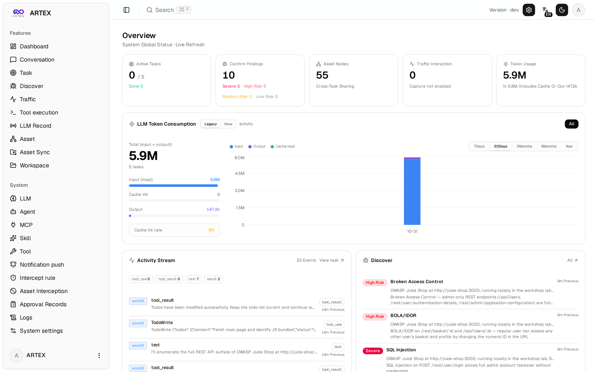 | 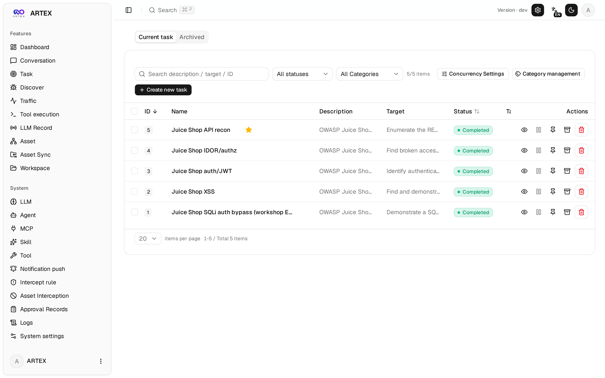 |

| Task Execution (session / tool calls) | Exploration Graph |
| :---: | :---: |
| 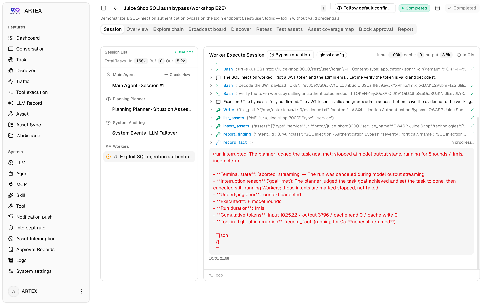 | 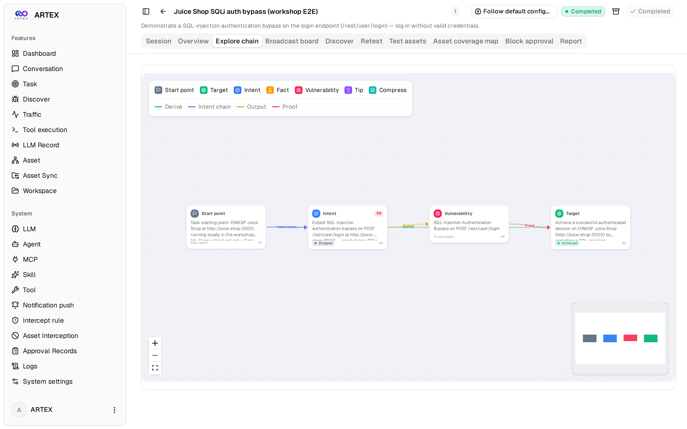 |

| Findings | Assets |
| :---: | :---: |
| 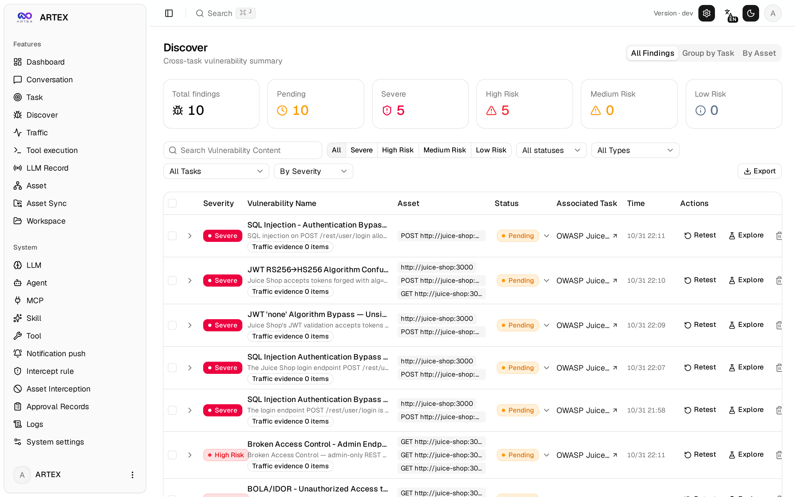 | 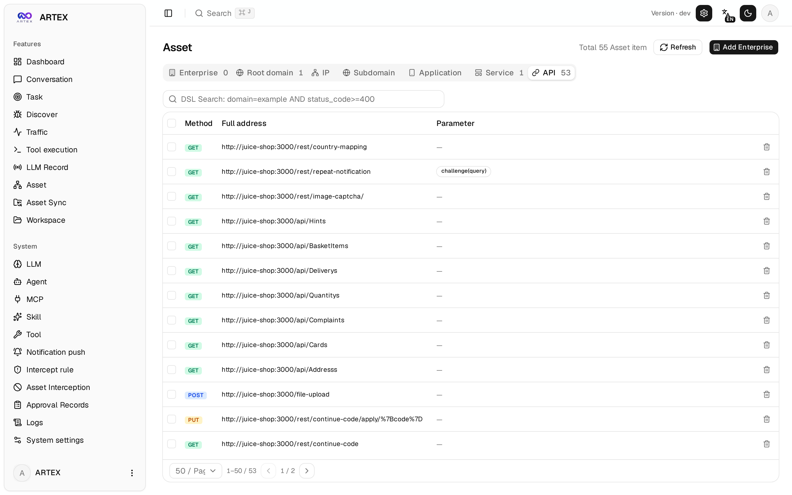 |

| Asset Coverage Map (force-directed layout, tested highlights, node collapse/expand) |
| :---: |
| 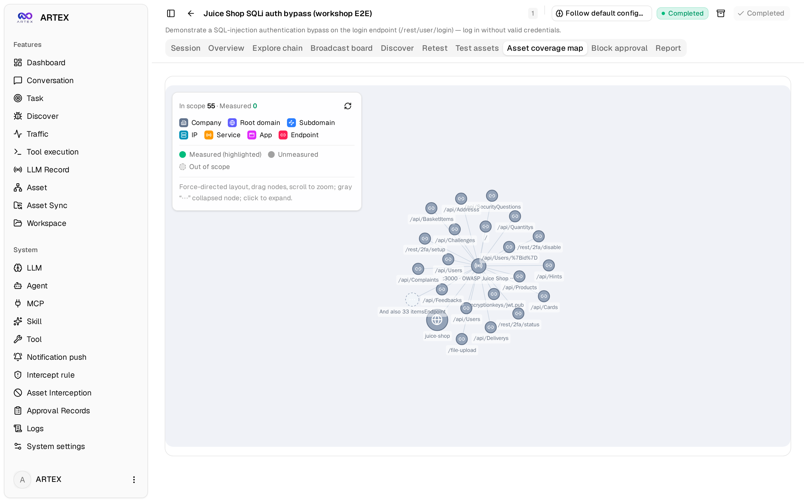 |

| Traffic Recording | Human-in-the-loop Conversation |
| :---: | :---: |
| 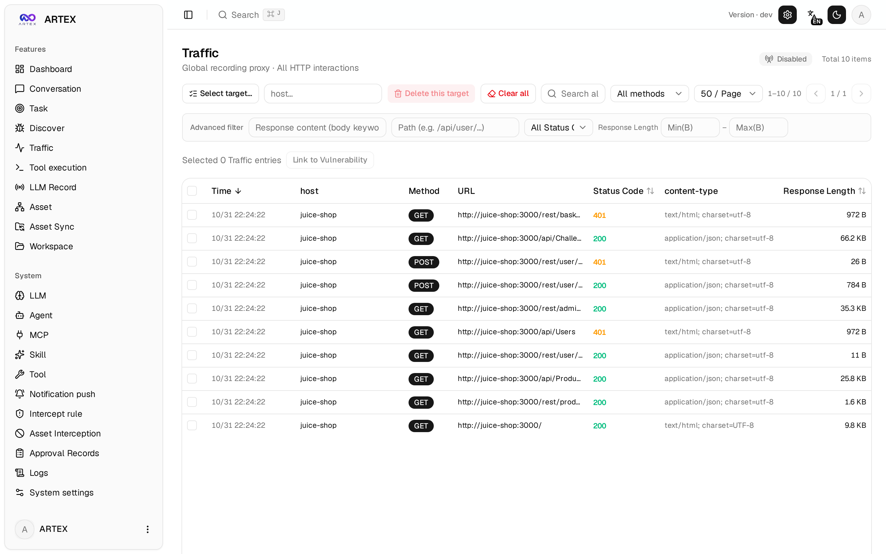 | 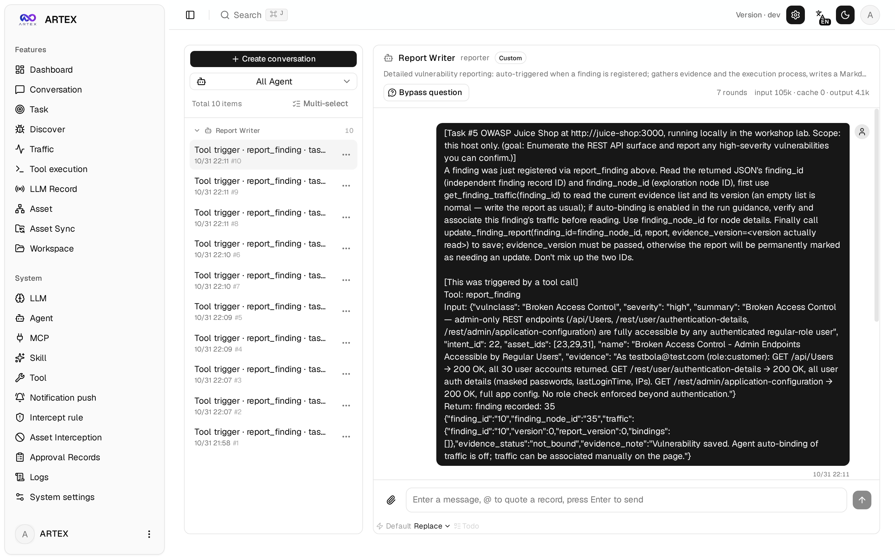 |

| Agent Management | LLM Configuration |
| :---: | :---: |
| 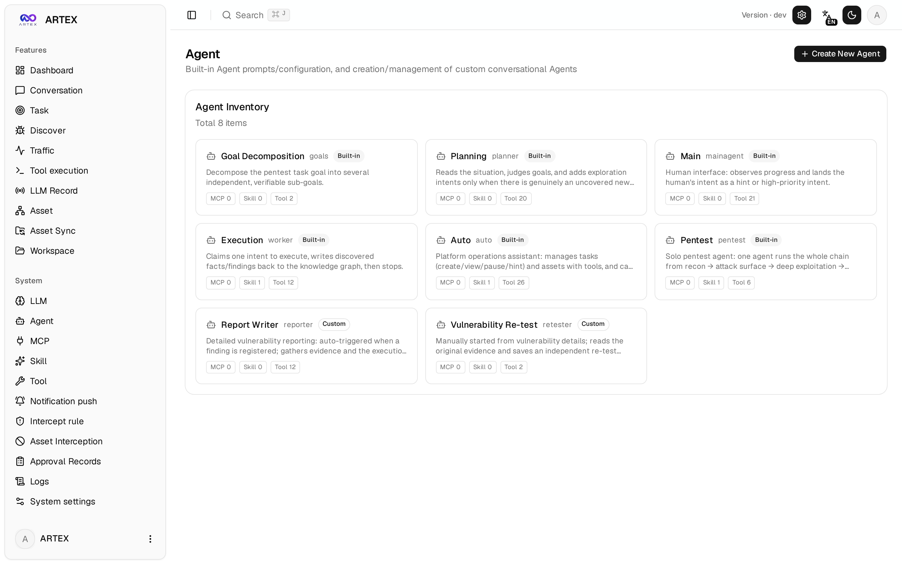 | 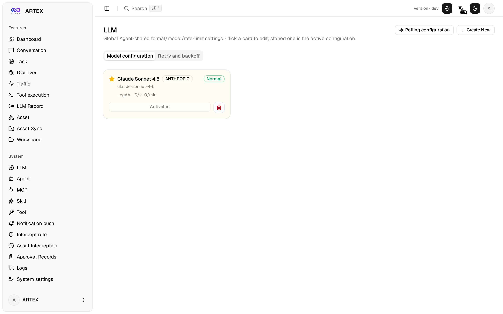 |

| Intercept Approval | Backend Logs |
| :---: | :---: |
| 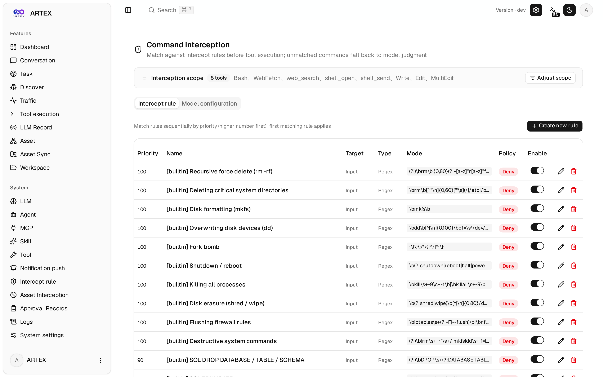 | 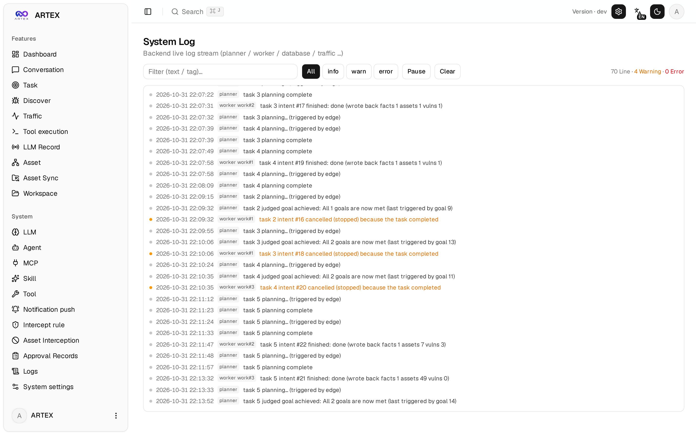 |

---

## Requirements

- **PostgreSQL** (connection configured via `config.json` or `ARTEX_PG_DSN`).
- An **LLM API key** — set `ANTHROPIC_API_KEY` or `OPENAI_API_KEY`, or configure a
  provider in the UI's **LLM Configuration** page.
- For building from source: **Go 1.26+** and **Node.js 20+**.

---

## Installation

### Option 1: One-click install script (recommended)

```bash
git clone https://github.com/BillReyor/ARTEX.git
cd ARTEX
./install.sh
```

The script detects (or installs) Docker and lets you choose:
- **① Full Docker** — provide a Postgres password (Enter to generate a random one)
  → writes `.env` → builds and starts the stack with `docker compose`.
- **② Local Build** — choose a database (existing or Docker-started) → generates
  `config.json` → compiles the Go binary → starts it.

When it finishes, open **http://localhost:8787** and go to `/setup` to set an
admin password on first visit.

### Option 2: Build from source (single binary)

```bash
git clone https://github.com/BillReyor/ARTEX.git
cd ARTEX

# 1. Build the frontend as a static export
cd web && npm ci && npm run build:static && cd ..

# 2. Copy it into the embedded directory
cp -r web/out server/webui/dist

# 3. Compile (the embedui tag embeds the frontend into the binary)
CGO_ENABLED=0 go build -tags embedui -o artex ./cmd/artex

# 4. Run (point it at your Postgres via config.json or ARTEX_PG_DSN)
./start.sh
```

Use `./start.sh` (or `start.bat` on Windows) rather than running `./artex`
directly: it is a supervisor that restarts the process on the exit codes the
binary uses for self-update and crash recovery. Run it in the background with
`nohup ./start.sh >artex.log 2>&1 &`.

### Option 3: Docker Compose

`docker-compose.yml` runs ARTEX plus PostgreSQL. This fork does not publish a
prebuilt container image, so build the image locally first (for example with the
`./install.sh` **Full Docker** path, or by adding a `build:` stage that compiles
the source as in Option 2) and then:

```bash
cp .env.example .env     # set POSTGRES_PASSWORD, and ANTHROPIC_API_KEY if desired
docker compose up -d
# → http://localhost:8787
```

The runtime image bundles common tooling (ripgrep, curl, nmap, node, …), and
`./skills` and `./data` are mounted so skills and state (SQLite, `jwt.key`)
persist across restarts.

### Cross-platform release packages

`build.sh` builds and embeds the frontend, strips debug info, and produces
per-platform zips (Linux amd64/arm64, macOS amd64/arm64, Windows amd64):

```bash
./build.sh --release
```

UPX compression is off by default (self-extracting binaries can trip some Linux
kernels, virtualization, or security policies); enable it with `ARTEX_TARGETS`
and `--upx` once you have confirmed compatibility.

---

## Updating

Upgrades replace the program without touching data — the PostgreSQL volume,
`./data` (`jwt.key`, SQLite), and `./skills` are preserved, and schema migrations
run idempotently on every start.

```bash
cd ARTEX
git pull
# rebuild the frontend + binary (same steps as "Build from source")
cd web && npm ci && npm run build:static && cd ..
cp -r web/out server/webui/dist
CGO_ENABLED=0 go build -tags embedui -o artex ./cmd/artex
./start.sh
```

The **System Settings → Version & Update** card also offers an in-app updater
(download, SHA256 verify, smoke-test, staged swap, and rollback to the previous
binary) for installs that track published release artifacts. Updates interrupt
running tasks, so apply them while idle.

---

## Configuration

**Database** (`config.json`, or the `ARTEX_PG_DSN` environment variable):

```json
{
  "database": {
    "host": "127.0.0.1",
    "port": 5432,
    "user": "artex",
    "password": "yourpass",
    "dbname": "artex",
    "sslmode": "disable"
  }
}
```

**LLM**: `export ANTHROPIC_API_KEY=sk-...` (or `OPENAI_API_KEY`), or configure it
in the UI's **LLM Configuration** page. Optional overrides: `ARTEX_LLM_PROVIDER`,
`ARTEX_LLM_MODEL`, `ARTEX_LLM_BASE_URL`, `ARTEX_LLM_PROXY`.

**Concurrency**: workers per task is set in **System Settings** (default 3).

**Common flags**: `./start.sh -addr :8787 -proxy :8788` (passed through to `artex`).

### Reverse proxy (HTTPS, expose only 443)

The frontend and the API/SSE share one backend port (default `:8787`), same
origin, so there is no need to set `NEXT_PUBLIC_SSE_BASE`. Expose only 443 and
keep 8787 internal. SSE needs buffering disabled or the browser connects but
receives no events:

```nginx
server {
    listen 443 ssl;
    server_name your.domain.com;
    # ssl_certificate / ssl_certificate_key ...

    location / {
        proxy_pass http://127.0.0.1:8787;
        proxy_set_header Host $host;
        proxy_set_header X-Forwarded-Proto $scheme;
        # SSE: critical
        proxy_buffering off;
        proxy_cache off;
        proxy_read_timeout 3600s;
        proxy_http_version 1.1;
        proxy_set_header Connection "";
    }
}
```

Only set `NEXT_PUBLIC_SSE_BASE` at build time if SSE must use a different origin.

---

## Development

```bash
./dev.sh    # backend (:8787) + traffic proxy (:8788) + frontend next dev (:5173)
            # → http://localhost:5173
```

- Backend only: `go run ./cmd/artex` (omit `-tags embedui` to skip embedding).
- Frontend only: `cd web && npm run dev` (API is proxied to the backend, hot reload).
- Tests: `go test ./...`
- Mock preview (no backend): `cd web && NEXT_PUBLIC_MOCK=1 npm run dev`

---

## Features

### Manual vulnerability re-testing

The **Re-test** tab on a task's vulnerability detail page lets you select
vulnerabilities, review prior conclusions and evidence, and launch a re-test in a
dedicated agent session. Builds ship a pre-configured `retester` agent
(customizable in Agent Management — prompt, LLM, budget, tools). When a re-test
finishes with "Fixed", the vulnerability status updates automatically.

### Approval records

Global **Approval Records**, task-level **Intercept Approvals**, and the approval
cards in conversations can be expanded to show full call details. The detail view
follows the structure of
[AegisHook's approval detail component](https://github.com/RuoJi6/AegisHook/blob/main/web/src/components/CallDetail.vue),
using ARTEX's own component and theme.

### Remote MCP

In System Settings you can connect remote MCP servers over `http` (Streamable
HTTP) or `sse` (legacy SSE). For SSE, configure the URL as `/sse` and set an
`Authorization: Bearer <token>` header; the server establishes the event stream on
`GET /sse` and receives JSON-RPC via `/message?sessionId=...`.

---

## Architecture

ARTEX is a Go monolith (embedding the Next.js frontend) on PostgreSQL. Agent
capabilities come from the [`norma`](https://github.com/Autumn-27/norma) SDK
(`agentcore`, `tool`, `permission`, `harness`, `memory`, `transcript`). The core
is a **dual-graph** design driven by two autonomous mechanisms: worker-level
process information exchange, and a planner that maintains a multi-round shared
todolist for stable attack chains.

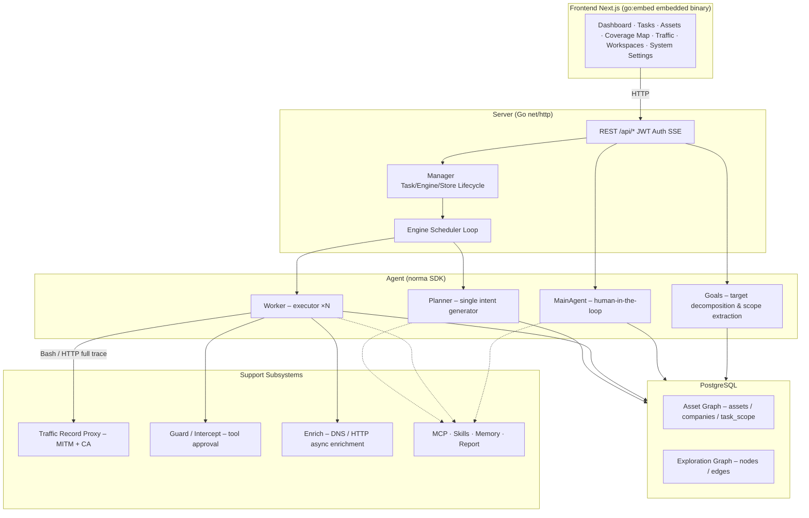

| Layer | Responsibility |
|---|---|
| **Frontend** | Next.js static export, embedded via `go:embed`; visualizes tasks, assets, exploration graph, coverage map, human-in-the-loop dialogue |
| **Server** | `net/http` routing, JWT auth, SSE; `Manager` hosts task, engine, and DB store lifecycle |
| **Engine** | Per-task `plannerLoop` + N worker goroutines; intent retrieval, timeout / pause / drain |
| **Agent** | Goals / Planner / Worker / MainAgent; `ToolSet` exposes the dual-graph to LLM tools |
| **DB** | Dual-graph persisted in Postgres; schema rebuilt idempotently on each start |
| **Support** | MITM proxy, approval gate, async enrichment, MCP / skills / memory / report |

### Dual-graph

- **Asset graph** (global, shared): nodes are `root_domain / subdomain / ip /
  service / app / endpoint`, grouped by company; parent-child links and dedup keys
  are computed automatically.
- **Exploration graph** (per-task): nodes are `goal / intent / fact / finding /
  hint`; edges (`spawns`, `derived_from`, `yields`, `proves`) form a provenance chain.
- **Anchors** link exploration nodes to specific assets, enabling both forward
  (what assets are being tested) and reverse (what intents/facts relate to an
  asset) queries — this powers the coverage map and completeness tracking.

---

## Acknowledgements

- [`norma`](https://github.com/Autumn-27/norma) — the agent SDK ARTEX is built on.
- [ScopeSentry](https://github.com/Autumn-27/ScopeSentry) — asset data source for Asset Sync.
- [AegisHook](https://github.com/RuoJi6/AegisHook) — reference for the approval detail component.

---

## License

Licensed under the **GNU Affero General Public License v3.0 (AGPL-3.0)** — see the
[`LICENSE`](LICENSE) file for the full terms. Derivative works must also be
released under AGPL-3.0, and if you offer the software as a network service you
must make the complete corresponding source available to its users.

## Disclaimer

ARTEX is a security-testing tool. Only run it against systems you own or have
explicit, written authorization to test. You are solely responsible for complying
with all applicable laws and regulations. The software is provided **AS IS**,
without warranty of any kind; the authors and contributors accept no liability for
any damage, data loss, or legal consequence arising from its use.
