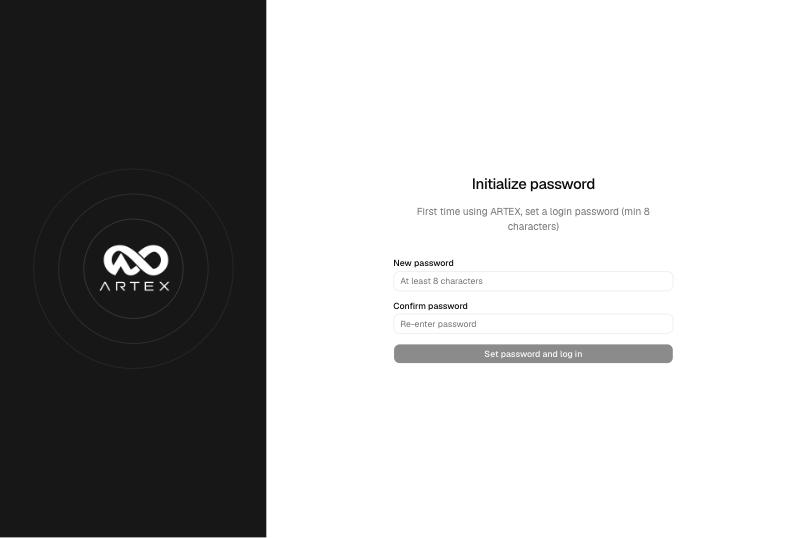
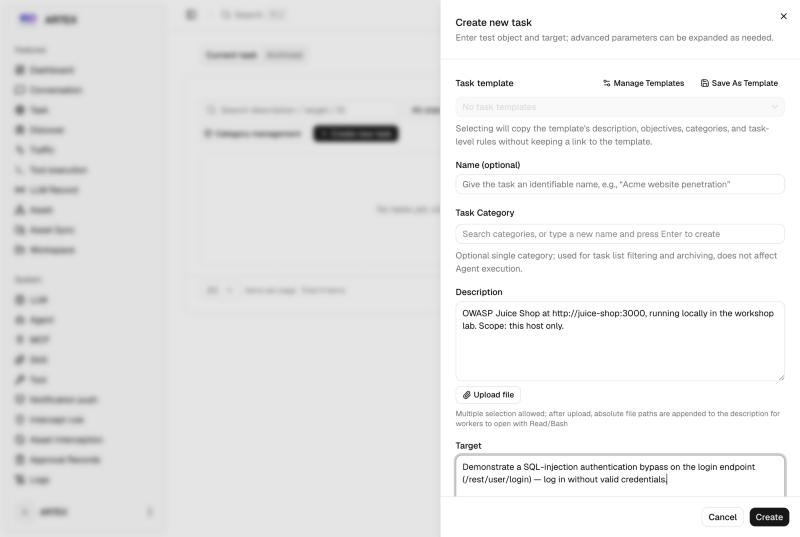
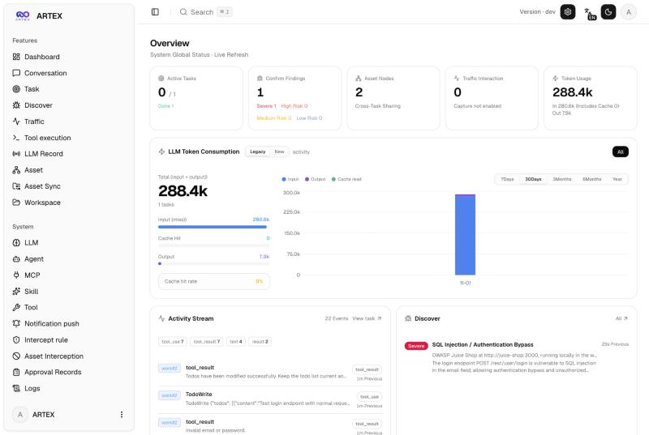
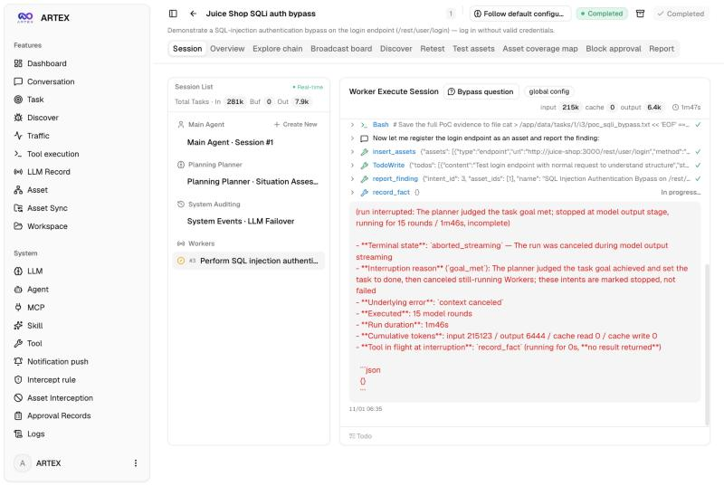
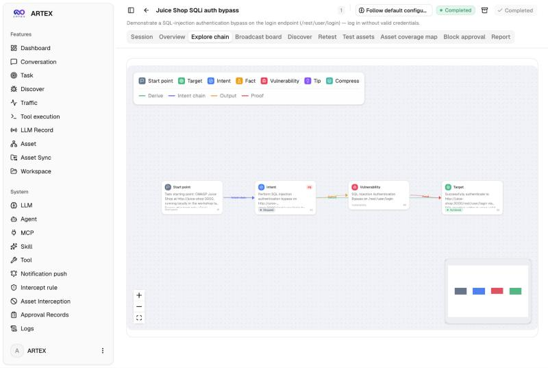
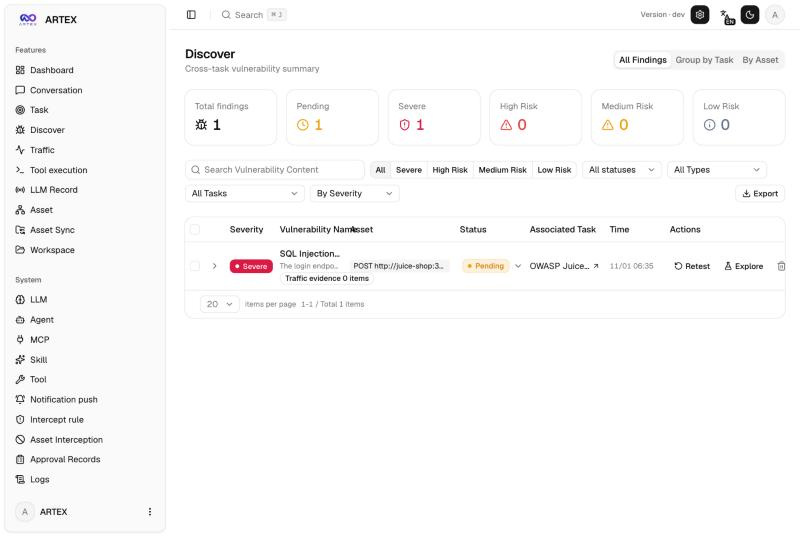

# ARTEX User Manual (Draft)

> Draft — covers ARTEX as built from the `BillReyor/ARTEX` (english-ui) fork.

## Contents

1. [What ARTEX is](#what-artex-is)
2. [Requirements](#requirements)
3. [Installation](#installation)
4. [First run and sign-in](#first-run-and-sign-in)
5. [Configuring the LLM](#configuring-the-llm)
6. [Core concepts](#core-concepts)
7. [How to use ARTEX (end to end)](#how-to-use-artex-end-to-end)
8. [Creating a task](#creating-a-task)
9. [Monitoring a run](#monitoring-a-run)
10. [Findings and evidence](#findings-and-evidence)
11. [Steering a run (human-in-the-loop)](#steering-a-run-human-in-the-loop)
12. [Re-testing a vulnerability](#re-testing-a-vulnerability)
13. [Reports and output](#reports-and-output)
14. [Operations](#operations)
15. [Safety and responsible use](#safety-and-responsible-use)
16. [Troubleshooting](#troubleshooting)
17. [Quick reference](#quick-reference)

## What ARTEX is

ARTEX is an LLM-driven autonomous penetration-testing system. You give it a target and a goal; its agents plan, run reconnaissance, attempt exploitation, and write up findings — while you watch and steer from a web dashboard.

Unlike a scripted scanner, ARTEX reasons as it goes: a planner proposes the next move, worker agents run tools (shell, HTTP, browser), and any action can be gated behind a human-in-the-loop approval rule. It records traffic through a built-in proxy and maintains two linked graphs — your assets and the exploration path — so every finding traces back to the evidence that produced it.

**Who it's for:** security engineers and testers running *authorized* tests against an isolated target. This manual describes the `BillReyor/ARTEX` (english-ui) build.

**A run at a glance:** create a task → agents recon and exploit the target → findings land in **Discover** with a proof-of-concept and evidence → you review, re-test fixes, and export a report.

## Requirements

- **PostgreSQL** — ARTEX stores all state here. Connection is set via `config.json` or the `ARTEX_PG_DSN` environment variable.
- **An LLM API key** — `ANTHROPIC_API_KEY` or `OPENAI_API_KEY`. This is where the cost comes from; ARTEX is autonomous, so budget for the model usage.
- **To build from source:** Go 1.26+ and Node.js 22.12+. (The Docker path builds these for you.)
- **Ports:** `8787` (dashboard + API) and `8788` (the traffic-recording proxy, bound to localhost).
- **Outbound network** to your LLM provider's API, plus the package registries and search providers the agent uses.

> ARTEX publishes no prebuilt container image — it is always built from source (via `install.sh`, `docker compose up -d --build`, or a manual `go build`).

## Installation

Pick one of three paths. All start by cloning the repo.

**Option 1 — one-click script (recommended).**

```
git clone https://github.com/BillReyor/ARTEX.git
cd ARTEX
./install.sh
```

The script detects or installs Docker, then offers **① Full Docker** (builds the image and starts ARTEX + PostgreSQL) or **② Local Build** (generates `config.json`, compiles the Go binary, runs it). When it finishes, open **http://localhost:8787**.

**Option 2 — Docker Compose.** From the repo root, set a Postgres password (and optionally your key) in `.env`, then:

```
docker compose up -d --build
```

This builds the image from source (Next.js frontend → Go binary → runtime) and starts the stack.

**Option 3 — build from source (single binary).**

```
cd web && npm ci && npm run build:static && cd ..
cp -r web/out server/webui/dist
CGO_ENABLED=0 go build -tags embedui -o artex ./cmd/artex
./start.sh
```

Always launch with `./start.sh` (or `start.bat` on Windows) rather than `./artex` directly — it supervises the process and restarts it cleanly.

## First run and sign-in

1. Open **http://localhost:8787**.
2. On first visit you land on **`/setup`** and set an **admin password** (minimum 8 characters). This happens once per machine.
3. On later visits you log in: the username is always **`ARTEX`**, plus your password. You must also tick the **"I have read and agree"** usage-notice checkbox before logging in.

> If you recreate the ARTEX container (for example after editing `.env`), the session signing key is regenerated, so you'll be logged out and need to sign in again. The password itself is stored in PostgreSQL and survives restarts.

## Configuring the LLM

The model is configured from environment variables, with an optional UI override.

- `ANTHROPIC_API_KEY` or `OPENAI_API_KEY` — the provider credential.
- `ARTEX_LLM_PROVIDER` — `anthropic` (default) or `openai`.
- `ARTEX_LLM_MODEL` — the model id (e.g. `claude-sonnet-4-6`).
- `ARTEX_LLM_BASE_URL`, `ARTEX_LLM_PROXY` — optional endpoint/proxy overrides.

On startup the log prints the active config, e.g. `LLM configured from env: anthropic / claude-sonnet-4-6`. You can also create and star a model profile in the UI under **System → LLM**.

> **Cost:** a cheaper model (Sonnet-class) keeps a run to roughly a few hundred thousand tokens; an Opus-class model costs several times more. Set the model deliberately before launching a task.

## Core concepts

**Agents.** A run is driven by cooperating agents:

- **Goal Decomposition** — splits the task goal into independent, verifiable sub-goals.
- **Planning** — reads the situation and adds one new exploration direction per loop.
- **Worker / Execution** — claims an intent, runs the tools, writes facts and findings back to the graph.
- **Main** — the human-in-the-loop interface: your messages become hints or high-priority intents.
- **Auto**, **Pentest**, **Report Writer**, **Re-test** — a platform-ops assistant, a solo end-to-end pentester, the agent that writes up findings, and the agent that re-validates fixes.

**The dual-graph.** ARTEX keeps two linked graphs:

- **Asset graph** (shared across tasks) — root domains, subdomains, IPs, services, apps, and endpoints, grouped by company.
- **Exploration graph** (per task) — goals, intents, facts, findings, and hints, joined by provenance edges. *Anchors* tie exploration nodes to specific assets, which powers the coverage map.

**Permission / intercept gate.** Before a tool runs, it is matched against intercept rules; you can auto-allow read-only actions and require approval for risky ones.

**Traffic proxy.** A built-in MITM proxy on `127.0.0.1:8788` records HTTP interactions so findings can be backed by captured requests and responses.

## How to use ARTEX (end to end)

This walkthrough takes ARTEX against a local **OWASP Juice Shop** target, from first launch to a confirmed finding. The screenshots are from a live run.

### 1. Set the admin password

On first visit to `http://localhost:8787` you land on `/setup`. Choose a login password (minimum 8 characters); the username is always `ARTEX`.



### 2. Create a task

Click **Create new task** and fill **both** fields — their names are unintuitive: put the **target + URL** in **Description**, and the **goal** in **Target**.



### 3. Watch the dashboard

The task runs autonomously once created. The **Dashboard** shows active tasks, findings by severity, token usage over time, and a live activity stream.



### 4. Follow the agent session

Open the task and select the **worker** session to watch the live tool-call stream — here the agent sends the SQL-injection payload, decodes the returned JWT, and records the finding.



### 5. Read the exploration graph

The **Explore chain** tab shows the provenance of the result: start point → intent → vulnerability → target (achieved).



### 6. Review the findings

Confirmed findings land in **Discover** with severity, the affected endpoint, status, and **Retest** / **Explore** actions.



That's the full loop: set up → define the task → watch it work → review the finding. From here you can confirm fixes (see *Re-testing a vulnerability*) and export the write-up (see *Reports and output*).

## Creating a task

Click **Create new task**. Two fields drive the run, and their names are unintuitive — **fill both**:

| Field | What it actually wants | Example |
| --- | --- | --- |
| **Description** | The **target + background** — *this is where the URL goes* | `OWASP Juice Shop at http://juice-shop:3000, local lab. Scope: this host only.` |
| **Target** | The **goal**, not the URL | `Demonstrate a SQL-injection auth bypass on /rest/user/login.` |

Give the task an optional name, then click **Create**. It runs autonomously by default (it does not pause for per-step approval unless you enable an intercept gate).

> Reach the target by the hostname it is actually served on. In a Docker Compose lab that is the Compose service name (e.g. `http://juice-shop:3000`), **not** `localhost`. Keep scope to systems you are authorized to test.

## Monitoring a run

Open the task to watch it work. The detail view has tabs:

- **Session** — live agent dialogue and the running token count; worker sessions show the real tool-call stream.
- **Explore chain** — the exploration graph: start point → intent → vulnerability → target, with the provenance edges.
- **Discover** — findings as they land.
- **Asset coverage map** — a force-directed view of in-scope assets and which have been tested.
- **Test assets**, **Broadcast board**, **Report** — the scoped assets, inter-agent notes, and the written report.

The **Dashboard** gives the global view: active tasks, confirmed findings by severity, asset nodes, recorded traffic, token usage over time, and a live activity stream. **Tool execution** lists every command the agents run.

## Findings and evidence

Findings collect on the **Discover** page (also per task). Each is rated **Severe / High / Medium / Low** and carries:

- a **name** and description of the vulnerability,
- the **affected asset / endpoint** (e.g. `POST /rest/user/login`),
- a **proof-of-concept** and the **evidence** the worker saved (written to the task's data directory),
- a **status** (Pending, Fixed, …) and the associated task.

You can filter by severity, status, type, or task, group **By Task** or **By Asset**, **link recorded traffic** to a finding as evidence, and **Export** the set. From a finding you can also launch **Retest** or **Explore** (jump to its place in the exploration graph).

## Steering a run (human-in-the-loop)

You are not limited to watching — three controls let you intervene:

- **Intercept rules** (*System → Intercept rule*) — commands are matched against rules before execution. ARTEX ships built-in **Deny** rules for destructive operations (e.g. `rm -rf`, `mkfs`, SQL `DROP`). Add your own rules and set the interception scope (which tools are gated); unmatched commands fall back to model judgment.
- **Approval Records** — when a gate requires sign-off, requests queue here (and as approval cards in conversations) for you to allow or deny.
- **Conversation / Chat** — message the **Main** agent to add a hint or a high-priority intent, redirecting the run without stopping it.

## Re-testing a vulnerability

After a fix, you can confirm it without a full re-run. On a task's **Re-test** tab (or the **Retest** action on a finding), select the vulnerability and launch a re-test. This opens a dedicated **retester** agent session that reads the original evidence and re-attempts the exploit.

When the re-test concludes the issue is resolved, the finding's status flips to **Fixed** automatically. The retester agent is customizable in **Agent** management (prompt, model, budget, tools).

## Reports and output

Each task has a **Report** tab with the written-up assessment. Underlying data lives in ARTEX's data directory, **`/app/data`** in the container (bind-mounted to **`./data`** on the host): the SQLite store, the session signing key (`jwt.key`), per-task evidence files, and reports.

Because that directory is bind-mounted, findings, sessions, and reports **persist on the host** across container restarts and rebuilds. The admin account and all primary state live in PostgreSQL, which also persists in its volume.

## Operations

**Start / stop.** `./start.sh` is a supervisor: it relaunches ARTEX by exit code (0 = clean stop, 75 = restart requested, anything else = crash → back off and restart) and forwards signals for a clean `docker stop`. Under Compose, use `docker compose up -d` / `stop` / `down`.

**Update.** Pull the latest source and rebuild:

```
git pull
cd web && npm ci && npm run build:static && cd ..
cp -r web/out server/webui/dist
CGO_ENABLED=0 go build -tags embedui -o artex ./cmd/artex
./start.sh
```

Under Docker, rebuild the image (`docker compose up -d --build`). Database migrations run automatically on every start (schema is applied idempotently), and data is preserved. Rebuilding interrupts running tasks — do it while idle.

**Reset the admin password.** Run `./reset-password.sh` (it reads the DB connection from `config.json` / `ARTEX_PG_DSN`, or `-m docker` to run inside the Postgres container). The username stays `ARTEX`; no restart is needed.

## Safety and responsible use

ARTEX is an autonomous offensive tool. Run it **only against systems you own or have explicit, written authorization to test**, and keep every task scoped to those hosts.

- **Isolate it.** The container (and a lab network pointed at a deliberately vulnerable target) is the safety boundary — ARTEX executes the commands its agents choose. Don't expose the dashboard on an untrusted network; it binds to localhost by default and `/setup` is unauthenticated until you set a password.
- **Scope tightly.** Put only authorized hosts in the task description, and use the intercept gate for anything higher-risk.
- **You are responsible** for complying with applicable laws and your rules of engagement.

Licensed under **AGPL-3.0** (see the repository `LICENSE`).

## Troubleshooting

- **Agents can't reach the target.** Use the hostname the target is actually served on. In a Compose lab that's the service name (`http://juice-shop:3000`), not `localhost`.
- **Logged out after a rebuild.** Recreating the container regenerates the session signing key — just log in again with username `ARTEX` and your password.
- **Database errors on startup.** Check `ARTEX_PG_DSN` / `config.json`, that PostgreSQL is reachable and healthy, and that the credentials match.
- **Port already in use.** Free `8787`/`8788`, or change them: `./start.sh -addr :8787 -proxy :8788`.
- **Task spins without findings.** Confirm the LLM key is valid (the startup log shows the configured provider/model) and that the scope/target actually point at a reachable, in-scope host.
- **Where to look.** `System → Logs` shows the live backend stream; from the host, `docker compose logs -f artex`.

## Quick reference

| Item | Value |
| --- | --- |
| Dashboard | `http://localhost:8787` |
| Traffic proxy | `127.0.0.1:8788` |
| Login username | `ARTEX` (password set at `/setup`) |
| LLM config | `ANTHROPIC_API_KEY` / `OPENAI_API_KEY`, `ARTEX_LLM_PROVIDER`, `ARTEX_LLM_MODEL` |
| Database | `ARTEX_PG_DSN` or `config.json` |
| Data on host | `./data` (→ `/app/data`: SQLite, `jwt.key`, evidence, reports) |
| **Task: Description** | target + background (**put the URL here**) |
| **Task: Target** | the goal (not the URL) |

**Common commands**

```
./install.sh                 # guided install
docker compose up -d --build # build + run the stack
./start.sh                   # run the binary under the supervisor
./update.sh                  # pull + rebuild
./reset-password.sh          # reset the admin password
```
