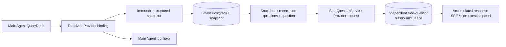

# ARTEX `/btw`

Normal chat, task MainAgent and the current task's own Worker support independent bypass questions. Enter `/btw question` in the main input box to submit. Leave `/btw` blank or use the "Bypass Question" button to open the history. Use an adjustable-width sidebar on desktop and Drawer on mobile.

The bypass answer is generated based on the Agent context snapshot at the time of submission, and supports streaming display, questioning, stopping and clearing. Closing the panel, refreshing the page, or disconnecting SSE will not cancel the model request. Stopping only affects the current bypass; clearing cancels the bypass and deletes the bypass history while retaining the main context snapshot.

## Implement boundaries

Inherit Go, norma v0.3.7, Next.js, and existing Markdown / ResizablePanel / Drawer / AlertDialog components; there is no modification to the norma source code or adding dependencies for bypass. Upgrades to Planner, Workers inherited from other tasks, and tool-type subtasks are not included in this scope.

- `capture.go` Only main loop requests are marked at `Options.Deps.CallModel / CallModelSync`. The Provider decorator is placed inside the concrete model, after the routing pool's outer selection, and therefore records the actual selected model; compression and digest requests do not overwrite snapshots.
- Request start, complete model reply, and run final state release snapshot. Half-part replies being generated are not published; tool calls remain paired via norma's `MessagesForAPI`, and tool results are entered into the snapshot at the next main model request or run final state. Streaming abort retains the last valid boundary.
- Snapshots preserve structured messages, system prompts, tool definitions, and build parameters through JSON deep copies. Model inference does not hold snapshot locks or database transactions.
- `SideQuestionService` calls a specific Provider; generates a bypass digest if necessary, and the final answer is only allowed to be retried once when the context is out of bounds for the first time and the text/tool call has not been output yet. It does not create an agent session, does not connect to tool executors, main transcripts, activity flows or task graphs, and does not go through the task model switching chain. Answers retain tool definitions for compatibility with existing structured tool contexts; summary requests do not provide tools. The newly returned tool call has no execution path.
- One running request per parent session, up to four single service processes, and a single timeout of 120 seconds. Bypass uses a separate cancellation context under the service lifecycle.
- Bypass requests preserve model configuration references and non-sensitive identity digests; credentials are obtained from the existing configuration when requested. If the configuration is deleted, or the identity fields such as model, protocol, address, etc. change, it is required to run the master Agent to update the snapshot first. Testing does not change the product default model.

## Persistence and recovery

`db/schema.sql` automatically creates `side_question_sessions` and `side_question_requests`. The former saves the parent resource, latest snapshot, running number, version and clean version; the latter saves questions, accumulated answers, status, model, snapshot time, usage, event serial number and paging serial number.

The parent session key uses conversation ID, or task ID + exploration ID + intent ID. Workers do not use reusable execution slot naming.

Snapshots are merged writes by parent session, refreshed every 250 ms, database comparison `(run_id, version)` prevents older versions from being overwritten. Save the selected snapshot again before bypassing the commit. Releases the large snapshot in memory after a successful save; retains the pending version on failure. The accumulated answer content is written at most every 250 ms when the streaming event arrives, and the final state is saved immediately and retried in limited time in the event of a database error.

The service startup marks the legacy `running` request as `interrupted`, retains some of the answers and usage that have been dropped, and does not automatically replay the request. The most recently successfully saved context can be used directly for the next question. Old sessions without snapshots require running the master Agent first and do not rebuild the context from UI activity records.

The purge operation increments the cleanup version and deletes the request; conditional updates prevent late callbacks from being written back. Physical parent resource deletions rely on foreign key cascading, and Worker tombstones delete bypass data within the same transaction and reject subsequent late snapshots. Task archiving first blocks new requests, waits for the main process to stop, cancels, and waits for the bypass to be dropped; the archive format is v3 and is compatible with v1/v2 without the bypass table.

The history is completely saved, and the cursor can return up to 20 items per page by serial number. The model requests the replay of the latest 20 successful sets of original Q&A at most, and limits the amount of replay based on the token budget; older Q&A maintains independent rolling summaries. When the main context exceeds budget, only the old portion of the bypass copy is digested, retaining recent structured tool calls and results. Summary and preparation progress are incorporated into bypass's concurrency, cancellation, and 120-second timeout limits along with usage. See [Context Budgeting and Open Source Reference](CONTEXT_BUDGET.md) for details.

## HTTP Contract

The following path is used as `{parent}`, and the existing authentication and resource verification are used:

- `/api/conversations/{id}`
- `/api/tasks/{id}/chat`
- `/api/tasks/{id}/intents/{iid}`

| Requests | Returns and Behavior |
| --- | --- |
| `GET {parent}/side-questions?before={ordinal}` | `items` arranged from new to old, independent `current` running status, `snapshot` meta information, `next_cursor`; cursor 0 means the latest page / no next page |
| `POST {parent}/side-questions` | JSON `{ "question": "…", "client_request_id": "UUID" }`; new requests return 202 and the request object; the same ID and question return the existing object 200 |
| `DELETE {parent}/side-questions` | Cancel and clear the bypass Q&A of the current parent session |
| `GET /api/side-questions/{requestID}/events` | `snapshot` SSE event, `id` is the incrementing sequence number, `data` is the complete cumulative request object; `cleared` is sent when clearing |
| `POST /api/side-questions/{requestID}/cancel` | Explicit cancellation; final state can be read from history or SSE |

Questions are limited to 4000 characters. No snapshot, model configuration changes, the same parent session is busy, or idempotent ID conflict returns 409; the global concurrency limit returns 429. Each SSE connection sends cumulative status first, without relying on previous text fragments received by the client. The front end merges by request ID + sequence number, and discards old callbacks when switching parent sessions and clearing.

## Verification and reference

Automated checks, actual model usage, and known limitations are available in [VALIDATION.md](VALIDATION.md).

Standalone request reference [Grok CLI side-question.ts (fixed commit)] (https://github.com/superagent-ai/grok-cli/blob/fb97af83f06dca873281d60168430f06c8de6324/src/utils/side-question.ts), run isolation reference [OpenCode (fixed commit)] (https://github.com/anomalyco/opencode/tree/b3f1a96c6dd7adeb28b36dd11add1998fc84d67b). The context of ARTEX uses norma's structured messages, without splicing text from front-end logs.
